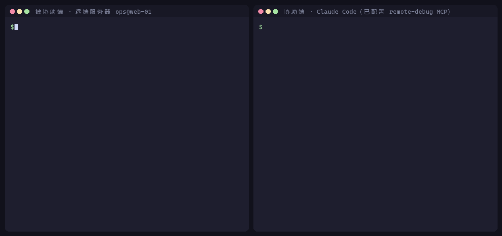
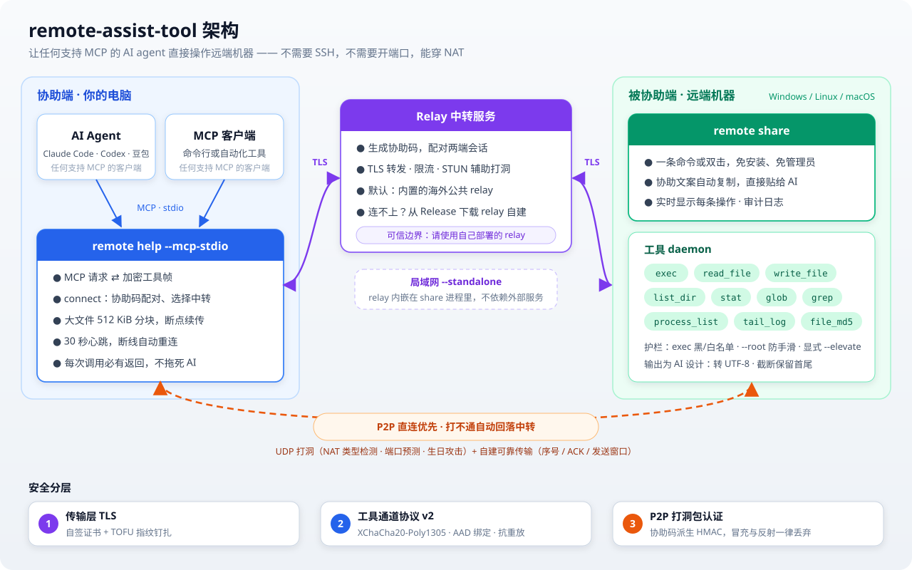

# Remote Assist Tool

English | [简体中文](README.zh-CN.md)



A command-line remote assistance tool: it sets up a secure tunnel through a relay server (or LAN direct connection / NAT-traversing P2P). It supports classic SSH remote assistance, and also lets a local **AI agent debug a remote machine directly through an MCP tool channel** — Claude Code, Codex, Doubao, or any other agent that supports MCP.

## Features

- **Two assistance channels**: a classic SSH tunnel; and an MCP tool channel (12 remote tools, including file upload/download) that works with any MCP-capable AI agent.
- **Three connection modes**: public relay; LAN direct connection via an in-process relay (`--standalone`); NAT-traversing P2P direct connection (STUN hole punching, automatically falling back to the relay on failure).
- **Layered encryption**: TLS on the relay link; the MCP tool channel additionally uses XChaCha20-Poly1305 AEAD with a key derived from the assist code, protecting against network paths outside the relay. **The relay itself is a trust boundary** (the assist code is generated by it, see [Security Features](#security-features) below), so use a relay you deploy yourself.
- **Guardrails**: exec command deny/allow lists; an optional `--root` that confines the file tools to a subtree (protection against slips, not a security boundary — exec is not bound by it).
- **Relay hardening**: connection rate limiting (global + per IP), read/write timeouts, and a per-message size cap, to resist resource-exhaustion DoS / slowloris.

## Quick Start

### One-line install of remote

The script downloads the client for your current OS and architecture from the latest official GitHub Release and installs it as
`~/.local/bin/remote` (`remote.exe` in Git Bash / MSYS2 / Cygwin on Windows):

```bash
curl -fsSL https://raw.githubusercontent.com/kegechen/remote-assist-tool/master/install.sh | sh
```

You can also use `wget`, or set the install directory with `REMOTE_INSTALL_DIR`:

```bash
wget -qO- https://raw.githubusercontent.com/kegechen/remote-assist-tool/master/install.sh | sh
REMOTE_INSTALL_DIR=/usr/local/bin sh install.sh
```

Supports amd64 and arm64 on Linux, macOS and Windows (Git Bash / MSYS2 / Cygwin);
on Linux/macOS the downloaded file is made executable automatically; on Windows, if the `curl` / `wget` download fails, the script falls back to
the system PowerShell.

Before installing, the script fetches the `SHA256SUMS` of the same Release and verifies the downloaded binary; on mismatch it aborts and leaves
no files behind. If the checksum list cannot be fetched it likewise aborts — to bypass this, explicitly set `REMOTE_INSTALL_SKIP_CHECKSUM=1`.

If you download manually, you can verify it yourself:

```bash
curl -fLO https://github.com/kegechen/remote-assist-tool/releases/latest/download/SHA256SUMS
sha256sum -c SHA256SUMS --ignore-missing   # macOS: shasum -a 256 -c SHA256SUMS --ignore-missing
```

Note that `SHA256SUMS` and the binary come from the same Release over the same HTTPS connection, so it protects against "what you downloaded is incomplete or was swapped in transit",
not "the Release itself was replaced" — the latter requires signatures, which this project does not provide yet.

### Build

Use the scripts in the repository; artifacts go to `bin/` (`.exe` on Windows):

```bash
# Windows
scripts\build.bat
# Linux / macOS
./scripts/build.sh
# Cross-compile Linux artifacts on Windows
scripts\build-linux.bat
```

All artifacts carry a platform suffix (`<component>-<os>-<arch>`), so you can tell at a glance which platform a binary is for, and it will not
collide with anything else on your PATH:

| Artifact | Description |
|---|---|
| `bin/remote-assist-cli-windows-amd64.exe` | The client: both the share and help roles, and also the MCP entry point |
| `bin/remote-assist-webui-windows-amd64.exe` | Browser console (looks for the cli above in the same directory / `bin/`) |
| `bin/remote-assist-relay-windows-amd64.exe` | Relay server |
| `bin/remote-assist-{cli,relay}-linux-{amd64,arm64}` | Produced by cross-compiling with `scripts/build-linux.bat` |

Windows artifacts embed product information (product name / description / version are visible in the file's Properties), generated by `goversioninfo` from
`git describe`. The tool is pinned into `go.mod` via `tools.go`: after one `go mod download`, you
**can build offline** and don't need network access every time.

> Tip: for a pure compile check use `go build ./...` (produces no files); to get artifacts, always pass `-o bin/` or use the scripts above, so executables don't end up scattered in the repository root.

### Upgrading share from the Web UI

After connecting, the Web UI compares the versions of help and share; when share is confirmed to be older, an upgrade prompt appears at the top. After you pick the CLI binary matching the
remote OS and architecture, the backend performs a "make before break" handover:

1. Through the old channel it probes the PID, the original executable path, the OS and the architecture. Before uploading it checks the candidate file's ELF/PE
   machine; only after confirming that Linux/Windows and amd64/arm64 both match does it upload in chunks, and then it runs
   `--version` remotely to verify.
2. It reuses the old share's parameters and starts new with an isolated `HOME` (a separate ClientID) and a fixed `--code-file`.
   When upgrading the default instance, the isolated `HOME` does not change its single-instance lock: while old holds the lock, new queues up to take over, so
   starting the default share again during the handover still fails immediately.
3. Still through the old channel, it reads the new code, actively connects to new and checks the version.
4. On Linux, after new is verified, the original file is atomically replaced and old is then terminated by PID. On Windows, the running old is first
   renamed to a backup name so the candidate file can take over the original path, and then new is started; after new is verified, old is terminated by PID and the
   backup is deleted; if the switch fails, the original file is restored through the old channel.

If any step before the switch fails, old is not terminated; if connecting to new fails, it tries to reconnect to old automatically. Currently only Linux/Windows amd64/arm64 shares
using an external relay are supported; `--standalone` / `--no-auth` are rejected.
If `--allow-exec` is configured, the `sh`/`powershell.exe`, `mkdir`, `chmod`, `kill` needed for the upgrade, as well as the candidate binary, must also be
allowed to run. After the original path is replaced, existing systemd / startup configurations need no file-name changes; the temporary takeover process keeps
using the isolated ClientID, and the next normal start from the original path restores the standard HOME/ClientID.

### Usage 1: Classic SSH remote assistance (via relay)

On the machine being assisted (sharing its local SSH):

```bash
remote share --server relay.example.com:8443
```

> `--server` is not required: if omitted, the built-in public relay `23.95.78.14:8443` is used; only fill in your own address when connecting to a self-hosted relay.

The program displays an assist code, for example:

```
协助码已生成: ABCD-EFGHIJ
有效期至: 2026-02-28 18:30:00
等待协助端连接...
```

By default only one share is allowed per user. To additionally share a different SSH service or use a different tool policy, explicitly create
a separate instance:

```bash
remote share --ssh 127.0.0.1:22 --server relay.example.com:8443
remote share --new-instance --ssh 127.0.0.1:2222 --server relay.example.com:8443
```

Starting the default instance a second time fails immediately and does not disconnect the instance that is already running. Each use of `--new-instance` creates
an independent assist code; while the code is valid, that process keeps the same code when its network drops and reconnects, but after the process exits, starting it again
generates a new code. When connecting to an external relay, share only makes outbound connections and does not need a local listening port per instance;
the `--ssh` port is just the local SSH service being proxied. In standalone mode each instance embeds a relay, so
you must also set a different `--standalone-listen` port for each one.

On the helper side (connect with the assist code; MCP mode is the default, add `--legacy-ssh` for a traditional SSH tunnel):

```bash
remote help --server relay.example.com:8443 --code ABCD-EFGHIJ --legacy-ssh
# You can also omit --server and use the built-in public relay directly
# Then in another terminal:
ssh -p 2222 user@127.0.0.1
```

> `--insecure` defaults to **true**: the built-in / standalone relays use self-signed certificates, so it works out of the box. When connecting to a relay with a certificate from a trusted CA, explicitly pass `--insecure=false` to enable certificate verification.
>
> Skipping verification does not mean there is no authentication: the first time you connect to a relay address, its certificate fingerprint is recorded in `~/.remote_assist_known_hosts` (TOFU, like SSH's known_hosts), and a later fingerprint change is refused. If the relay really did change its certificate, add `--trust-new-cert` to trust it again, or delete the corresponding line in that file. Connections to `localhost` / `127.0.0.1` are not pinned (loopback has no man-in-the-middle to defend against, and multiple relays on one machine would share the same address key).

### Usage 2: LAN direct connection (standalone, no external server)

The machine being assisted starts a self-signed TLS relay inside its own process and listens on the LAN; the help side connects directly to that machine, with no dependence on any external server:

```bash
remote share --standalone --standalone-listen :8443
```

The console prints the command for the help side (the LAN IP is detected automatically):

```
================ standalone (LAN) mode ================
Relay (TLS, self-signed) listening at: 192.168.1.23:8443 (LAN reachable)
Help side connects exactly like a normal relay (no --plain needed):
    remote help --server 192.168.1.23:8443 --code <code> --p2p disabled
=======================================================
```

> The standalone self-signed certificate only covers `localhost`; in LAN scenarios keep the default `--insecure=true` (do not use `--insecure=false`, which fails because the certificate's SAN does not include the LAN IP).
>
> The certificate is stored in `~/.remote_assist_standalone_certs/` and reused across launches (regenerated only when close to expiry), so that the help side's fingerprint pinning keeps matching. Deleting this directory switches to a new certificate, after which existing help sides need `--trust-new-cert`.

### Usage 3: AI agent remote debugging via MCP

Let a local AI agent debug the remote machine directly, with no openssh-server needed on the remote side. `remote help --mcp-stdio`
is a standard stdio MCP server, and any MCP-capable agent such as Claude Code, Codex or Doubao can plug into it.
For first-time setup, you can simply hand [`MCP_SETUP.md`](MCP_SETUP.md) (Chinese) to your AI assistant and let it complete the
`remote` download and the `remote-debug` MCP configuration automatically.

Start share on the remote side (with the sandbox):

```bash
remote share --server relay.example.com:8443
```

Configure it locally as an MCP server. Taking Claude Code as an example (`.mcp.json` in the project root or `~/.claude/mcp.json`):

```jsonc
{
  "mcpServers": {
    "remote-debug": {
      "command": "remote",
      "args": ["help", "--server", "relay.example.com:8443", "--mcp-stdio"]
    }
  }
}
```

`--server` in the configuration can also be omitted; when omitted, the MCP server uses the built-in public relay. Only a self-hosted relay needs `--server <host>:<port>`.

For other agents, fill in the same thing in their own configuration format: command `remote`, arguments `help --server <relay> --mcp-stdio`,
and we recommend naming the MCP server `remote-debug`.

Note that there is **no `--code`** — this is bootstrap mode, where the MCP server does not yet know the assist code when it starts.

For each debugging session:

1. Run `remote share` on the remote side and get the assist code `ABCD-EFGHIJ`;
2. Tell your AI assistant directly: "**The assist code is ABCD-EFGHIJ, connect to it**" (when `remote share` starts it has already copied the whole assist message to the clipboard, so pasting it works too);
3. The agent calls `remote-debug:connect("ABCD-EFGHIJ")` to complete the handshake; for standalone/LAN you can add the address: `connect("ABCD-EFGHIJ", server="192.168.1.23:8443")`;
4. After that, all calls go straight to the real tools, with no need to restart the agent.

If the peer is an old 0.0.x version, `connect` is refused with an explanation; with the user's consent, call `connect("ABCD-EFGHIJ", min_proto="1")` in the same session to connect in compatibility mode, without restarting the agent or MCP (see "Compatibility" below for the risks). The old usage with a hard-coded `--code` has no `connect` step, so you still need to add `--min-proto=1` to the startup arguments.

The old usage (hard-coding the assist code) is still supported: add `"--code", "ABCD-EFGHIJ"` to args to skip bootstrap.

> If `connect` fails immediately with `Transport closed` and returns no `session_id` / `peer_host`, the request usually
> never reached the `remote` CLI. Do not conclude from this that the assist code is invalid or the relay is down; first restart the affected agent
> process (Claude Code, Codex, etc.), then retry with the same code. Once the host has cancelled the old stdio handle, calling `connect` repeatedly
> cannot recover it. For detailed evidence and troubleshooting steps see [`MCP_SETUP.md`](MCP_SETUP.md#4-排查-transport-closed) (Chinese)
> and the [`remote-debug` MCP integration reference](docs/remote-debug-MCP接入参考.md#6-错误码与排错) (Chinese).

## Architecture



- **Helper side**: the AI agent (or the browser console) calls the local `remote help` via MCP stdio, which wraps requests into encrypted tool frames;
- **relay**: issues assist codes, pairs sessions, forwards messages, and assists hole punching. It is a trust boundary, see [Security Features](#security-features);
- **Assisted side**: `remote share` only connects outward; the tool daemon executes commands and file operations, and every call is displayed in the terminal in real time;
- **P2P first**: if NAT traversal succeeds the connection is direct, otherwise it automatically falls back to the relay; the classic SSH tunnel mode uses the same connection.

## Command-Line Reference

### Default relay and self-hosting

When `--server` is not passed, `remote share` / `remote help` connect to the built-in public relay `23.95.78.14:8443`, which is deployed **overseas**.
It works out of the box, but self-hosting is recommended in two cases:

- **Cannot connect or it is slow**: access to overseas servers is unstable from some networks;
- **You want to control the trust boundary yourself**: the relay can derive the session key of the tool channel (see [Security Features](#security-features)), so sensitive environments should use only their own relay.

Self-hosting is simple: download the `remote-assist-relay-<os>-<arch>` for your platform from the [GitHub Release](https://github.com/kegechen/remote-assist-tool/releases/latest)
(amd64 and arm64 for Windows / Linux / macOS are available), run it on a machine reachable from both ends,
and open TCP 8443; on both ends use `--server <host>:8443`, or set the environment variable `REMOTE_RELAY_SERVER=<host>:8443` to point to it.
When both ends are on the same LAN, it is easier to just use `remote share --standalone`, which needs no separate relay.

### relay — relay server

| Option | Default | Description |
|------|--------|------|
| `--listen` | `:8443` | Listen address |
| `--cert` / `--key` | - | TLS certificate / private key files |
| `--ttl` | `30m` | Assist code lifetime |
| `--length` | `10` | Assist code length |
| `--audit` | `audit.log` | Audit log file |
| `--stun` | empty | STUN/UDP relay listen address; e.g. `:3478`, empty disables it |
| `--trust-source-ip` | `true` | Whether the relay can see the real source IP from the TCP connection; set to `false` for SNAT backends |
| `--limits-file` | `$REMOTE_RELAY_LIMITS_FILE` | JSON rate-limit configuration file; if unset, safe defaults are used |
| `--latest-version` | relay's own version | Latest version announced to clients; older clients print an upgrade hint (hint only, never rejects). Must be a release tag like `v1.2.3`; a non-release relay build announces nothing. `none` disables |
| `--download-url` | GitHub asset of that version | https URL template for the hint; `{version}`/`{os}`/`{arch}`/`{ext}` are expanded for the client's (or the shared peer's) platform. Verify links with `go test -tags network ./internal/update -run TestReleaseURLsExist` |
| `--release-page` | GitHub release page of that version | Fallback link when the platform is unknown or has no released asset |
| `--print-default-limits` | `false` | Print the complete default rate-limit JSON and exit |
| `--no-auth` | `false` | Fixed-code mode without authentication, only for fully trusted private networks |
| `--plain` | `false` | Non-TLS mode (development and testing only) |
| `--gen-certs` | `false` | Generate self-signed certificates and exit |
| `--certs-dir` | `./certs` | Certificate directory (a self-signed certificate is generated here automatically when cert/key are not specified) |
| `--version` | `false` | Show version |

For how the relay determines source IPs, the full rate-limit parameters, the rationale for the defaults, public STUN behavior, and deployment monitoring, see the [Relay Source IP, Rate Limiting and Monitoring Guide](docs/RELAY_LIMITS.md) (Chinese).

On Windows, double-clicking a relay with no arguments opens a service management menu. You can also install and manage the native Windows service with non-interactive commands:

```powershell
remote-assist-relay-windows-amd64.exe service install
remote-assist-relay-windows-amd64.exe service start
remote-assist-relay-windows-amd64.exe service status
remote-assist-relay-windows-amd64.exe service stop
remote-assist-relay-windows-amd64.exe service uninstall
```

The service program is installed to `C:\Program Files\RemoteAssistRelay`, the configuration, certificates and audit files are in `C:\ProgramData\RemoteAssistRelay`, and runtime logs are written to the Windows Application Event Log. For service mode, configuration format, permissions and uninstall behavior see [Windows Relay Service Deployment](docs/WINDOWS_RELAY_SERVICE.md) (Chinese). The original foreground arguments remain compatible; using `run` explicitly avoids confusion with the service management commands:

```powershell
remote-assist-relay-windows-amd64.exe run --listen :8443 --ttl 1h
```

### remote share — assisted mode

| Option | Default | Description |
|------|--------|------|
| `--server` | built-in public relay `23.95.78.14:8443` | Relay server address (can also be overridden by the environment variable `REMOTE_RELAY_SERVER`). The default relay is overseas, see "Default relay and self-hosting" above |
| `--insecure` | `true` | Skip TLS verification (for self-signed relays; set to `false` when connecting to a relay with a trusted CA) |
| `--ca` | - | CA certificate file |
| `--trust-new-cert` | `false` | Accept a relay certificate fingerprint that differs from the one recorded on first connection and record it again (use when the relay really changed its certificate) |
| `--ssh` | `127.0.0.1:22` | Local SSH address (SSH tunnel mode) |
| `--new-instance` | `false` | Start an additional independent share; generates a new assist code and does not affect the default instance |
| `--p2p` | `auto` | P2P mode: `disabled` / `auto` / `required` |
| `--stun` | - | STUN server address (defaults to the relay's :3478) |
| `--bind-ip` | - | Specify the UDP bind IP (bypasses TUN proxy auto-detection) |
| `--standalone` | `false` | Start a relay in-process and listen on `--standalone-listen`, for LAN direct-connection scenarios |
| `--standalone-listen` | `:8443` | standalone relay listen address |
| `--code-file` | - | After registration, atomically write the assist code + expiry as JSON to this file (for a host program to read) |
| `--root` | - | Optional: confine the file tools to this subtree (unset = unrestricted). Protection against slips, not a security boundary |
| `--allow-exec` | - | exec command allow list (comma-separated; empty = bound only by the deny list) |
| `--deny-exec` | `rm,shutdown,reboot,mkfs,dd` | exec command deny list |
| `--elevate` | `false` | Windows: request administrator privileges via UAC at startup |
| `--unsafe-exec` | `false` | **Dangerous**: disables the exec deny/allow lists so any command can run (startup shows a 5-second red confirmation countdown). Does not affect `--root` |
| `--plain` | `false` | Non-TLS (development only) |

### remote help — assistance mode

| Option | Default | Description |
|------|--------|------|
| `--server` | built-in public relay `23.95.78.14:8443` | Relay server address (can be overridden by `REMOTE_RELAY_SERVER`) |
| `--code` | - | Assist code (required for SSH / direct mode; leave empty in MCP bootstrap mode, where the `connect` tool supplies it) |
| `--insecure` | `true` | Skip TLS verification (same as share) |
| `--ca` | - | CA certificate file |
| `--trust-new-cert` | `false` | Same as share |
| `--listen` | `127.0.0.1:2222` | Local listen address (SSH tunnel mode) |
| `--p2p` | `auto` | P2P mode: `disabled` / `auto` / `required` |
| `--stun` | - | STUN server address |
| `--bind-ip` | - | Specify the UDP bind IP |
| `--mcp-stdio` | `false` | Run as an MCP stdio server (for any MCP-capable AI agent) |
| `--legacy-ssh` | `false` | Force the traditional SSH tunnel mode (this is the mode when `--mcp-stdio` is not given) |
| `--plain` | `false` | Non-TLS (development only) |

## MCP Tools Overview (12)

| Tool | Description |
|------|------|
| `connect` | Pair with the remote side using the assist code; must be called first; optional `server=` overrides the relay address (for standalone/LAN) |
| `exec` | Run a command on the remote side by argv (not through a shell) |
| `read_file` / `write_file` | Read / write remote files (limited to the `--root` subtree if set; at most 1 MiB per call) |
| `list_dir` / `stat` / `glob` / `grep` | Explore the remote file system |
| `process_list` | List remote processes |
| `tail_log` | Read the last N lines of a remote log |
| `upload_file` | Push a local file to the remote side in chunks (512 KiB) — binaries such as DLL/EXE/zip |
| `download_file` | Pull a remote file to the local machine in chunks — crash dumps / log archives, etc. |

`upload_file` / `download_file` are host-side composite tools that loop over `write_file` / `read_file` internally, with zero changes on the share side.

## Security Features

- TLS on the relay link (self-signed or trusted CA); `--insecure` controls whether it is verified. When verification is skipped it degrades to TOFU fingerprint pinning (`~/.remote_assist_known_hosts`), shrinking the man-in-the-middle window from "forever" to "only the first connection"; loopback addresses are not pinned.
- The MCP tool channel derives a session key from the assist code (HKDF-SHA256) and uses XChaCha20-Poly1305 AEAD: network paths outside the relay can neither see nor modify the tool content.
- **The relay is a trust boundary, not an untrusted pipe**. The assist code is generated by the relay, and the nonces of both sides of the handshake are also forwarded through it — all inputs used to derive the session key are visible on the relay side. So whoever controls the relay process can derive the key themselves, and decrypt or forge the tool data of active sessions. AEAD defends against the relay's ordinary forwarding logic misreading or mis-modifying data, but not against a compromised relay. Conclusion: **use only a relay that you deployed yourself and trust**; when using `--standalone` on a LAN the relay runs inside the share process, so there is no third party. See [docs/security/SECURITY_SR005_TRUST_MODEL.md](docs/security/SECURITY_SR005_TRUST_MODEL.md) (Chinese) for details.
- Tool channel protocol v2 adds three things on top of AEAD (**incompatible with v1**, see below):
  - **AAD binds the plaintext fields**: `tool` / `id` / `deadline_ms`, the response's `ok` / `error_code` / `error_msg`, and the stream frame's `seq` / `stream` are all outer plaintext. Once they are in the AAD, re-attaching a captured ciphertext to a different tool (e.g. attaching the arguments of `read_file` to `write_file` so the remote side truncates a file to 0 bytes), changing the ID, changing the timeout, flipping success to failure, reordering stream frames or delivering them across streams all fail to decrypt.
  - **Every response is sealed** (including error responses with an empty result), and the receiving side authenticates before looking at `ok`. Otherwise a man-in-the-middle could simply clear the `result` of a successful `read_file`, and the caller would get "empty result + success" — the AI would conclude "this file is empty", with no other way to notice.
  - **After the handshake, args must be ciphertext**: including calls with "no arguments", for which the host also seals a `{}`. The earlier criterion was "decrypt only if args are present", which amounted to a backdoor — sending a `tool_req{tool:"process_list"}` without args would bypass all decryption and trigger remote execution directly. Now anything without valid ciphertext is rejected before Dispatch.
  - **Replay protection**: the nonce is chosen by the sender; AAD can stop field tampering but not verbatim replay. The receiving side deduplicates by call ID with a 1024-bit sliding window (same semantics as IPsec), and a replay returns `replayed`. There is one window per key; it is reset on re-handshake and kept across a P2P hot upgrade (which does not change the key).
- P2P hole-punching packets carry an HMAC derived from the assist code and bound to the sender's identity: knowing only the sessionID (which is not a secret anyway, since during hole punching it is actively sprayed to a batch of ports on the peer's public IP) is not enough to forge a hole-punching packet or to impersonate the peer.
- **Compatibility: by default there is no interoperation with old versions (0.0.x); when needed, relax it explicitly with `--min-proto=1`.**
  - The tool channel version is negotiated in ToolHello/ToolHelloAck: each side advertises the set of versions it supports, and the highest one in the intersection is chosen. `0.0.1`~`0.0.9` are v1, and `1.0.0` onward are v2.
  - **Downgrades are refused by default**. If automatic downgrade were allowed, an untrusted relay could just delete the `versions` field from Hello and silently push two v2 peers back to v1, getting a channel with no AAD and no replay protection for free, and with no way to detect it afterwards. So relaxing must be an explicit user decision.
  - When an old version is encountered, the handshake fails with an actionable hint (rather than a bare `unsupported tool protocol version`). **The parameter always goes on the newer side** — the old version simply does not have this flag:
    - New help connecting to old share → relax on the **help side**, using any one of three entry points:
      - Command line: restart with `--min-proto=1` (in command-line mode, hitting an old version aborts directly and does not downgrade automatically);
      - MCP (AI agent): **no need to restart MCP or change the configuration**. When `connect` is refused, the error message prompts the AI to first explain the risk to the user and get consent, then retry by calling `connect(code, min_proto="1")` in the current session. This parameter applies only to that one connection (including automatic reconnection after a transport interruption), and overrides the startup flag `--min-proto`. It is only a lower bound: an existing v2 session satisfies it, and passing it again does not cause a disconnect and reconnect;
      - GUI: tick "Compatibility with old versions" in the connection bar and reconnect. Automatic reconnection after a drop keeps this setting; after the peer is successfully upgraded through the GUI it is unticked automatically, restoring the default of no downgrade.
    - Old help connecting to new share → add `--min-proto=1` on the **share side** (the hint is printed both on the local share machine and in the old help's terminal).
  - After downgrading to v1, the result of MCP `connect` carries `proto_version:"1"` and a `warning`, the GUI terminal prints a warning, and the "Tool protocol" field in the connection details also indicates compatibility mode. On a normal connection `proto_version` is `"2"`.
  - Relaxing only lowers the floor; it does not force a downgrade: when both sides support v2, v2 is still negotiated. When it really drops to v1, both sides print a conspicuous warning, because that means AAD binding, mandatory ciphertext arguments and replay protection are all turned off together.
  - **When interoperating with 0.0.x there is no P2P direct connection; everything goes through the relay**: once v1 is negotiated, the new side no longer sends any hole-punching packets and does not switch traffic to a tunnel. The reason is that hole-punching authentication can only take effect in one direction — we reject the old version's packets that lack a MAC, but the old version only compares `session_id`, does not know the `mac` field at all, and will accept our packets as they are and **unilaterally** conclude that P2P is up, then send traffic into a tunnel that we never established on our side. Not sending packets is the only way to keep the state of both ends consistent.
    - To be clear: the share side's address advertisement may already be sent before the tool handshake (`advertiseAddr` is inside `mgr.Start()`, while the handshake only arrives after `SessionReady`), so the old peer may still punch by itself and wait idly until its own timeout. That waste is on the peer's side and we cannot change its code; avoiding it entirely would require deferring the P2P start, but before the handshake arrives it is impossible to tell whether this is a tool session or an SSH session, and deferring would disable P2P for SSH as well. This does **not** create a black hole: the new side never replies and never switches to the tunnel.
    - With `--p2p=required`, both sides immediately report an error explaining the reason (instead of waiting idly for the hole-punching timeout). The share side replies with a refusal carrying the reason already in the **handshake phase** — "peer too old" is also a kind of P2P failure, and the user has explicitly said they do not accept relaying, so this session was never viable; if it accepted first and cut the connection afterwards, the peer would only see an unexplained loop of "handshake succeeded → tunnel_lost → reconnect". 0.0.x prints the refusal reason verbatim.
  - Even with `--min-proto=1`, two new peers that **both support v2** are still never downgraded: the responder's `versions` is its testimony of "what I support", and if both sides could use a higher version but a lower one was negotiated, the proposal was modified in transit, and the initiator refuses the handshake on that basis. A real 0.0.x does not send this field and is unaffected.
  - The hole-punching verification itself is **not relaxed by `--min-proto=1`** — if authentication could be bypassed by "claiming to be an old version", it would effectively not exist. Compatibility mode is a feature downgrade, not an authentication downgrade.
- Assist code: securely randomly generated (a 54-character set × 10 characters, with easily confused characters removed), expiring after 30 minutes by default.
- **The trust boundary is the assist code**: share is actively started by the local user, and whoever is given the code is effectively given the machine. `--root` / the exec lists are guardrails against slips, not a boundary against a malicious party — exec can run any program, and a single `sh -c 'cp /etc/passwd <root>/'` bypasses `--root`. If you need real isolation, wrap the process externally (container / dedicated low-privilege account).
- Relay server hardening: global + per-IP connection limits, read/write timeouts, and a per-message size cap.
- Full audit log.

## Comparison with Similar Tools

| Feature | This tool | frp | ZeroTier | ngrok |
|------|--------|-----|----------|-------|
| **Core function** | SSH/MCP remote assistance | Reverse proxy | Virtual LAN | NAT traversal |
| **Use case** | Ad-hoc assistance / remote debugging | Long-term service exposure | Building a virtual network | Temporary public access |
| **Setup complexity** | Very low (one assist code) | Medium | Medium | Low |
| **Self-hosting** | ✅ Supported | ✅ Supported | ❌ (a self-hosted edition exists) | ❌ Depends on the official service |
| **Connection modes** | Relay / P2P / LAN direct | Relay only | P2P first | Relay only |
| **One-off use** | ✅ Designed for ad-hoc use | ❌ Leans long-term | ❌ Leans long-term | ✅ Ad-hoc |
| **AI integration** | ✅ MCP (any MCP-capable agent) | ❌ | ❌ | ❌ |

## Advantages of This Tool

1. **Minimal** — `share` generates a code, `help` / the AI agent connects with it: two steps and you're done.
2. **Assist codes expire** — they automatically become invalid after 30 minutes by default.
3. **Three connection modes** — public relay, LAN direct, and P2P direct are chosen automatically by scenario.
4. **Fully self-hosted** — your data stays under your control.
5. **AI-native** — a standard MCP server that you can attach to Claude Code, Codex, Doubao or any other MCP-capable agent as a remote debugging tool.

## License

[MIT](LICENSE)
